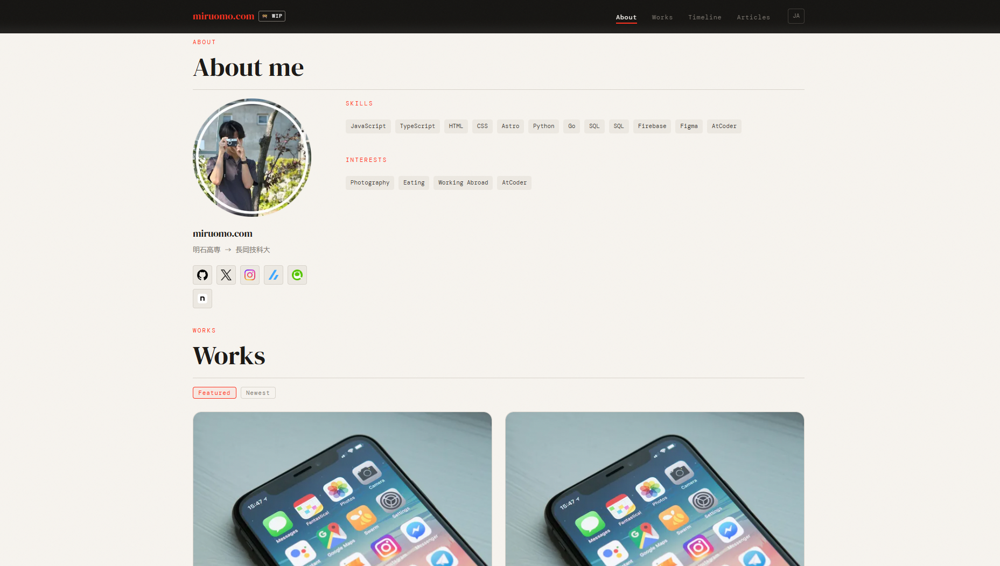

# miruomo.com

miruomo（[@QwerTayu](https://github.com/QwerTayu)）のポートフォリオサイトです。

https://miruomo.com/ （英語版：https://miruomo.com/en/）



## 概要

1ページ構成のサイトで、上から次のセクションが並んでいます。

| セクション | 内容 |
|---|---|
| Hero | 名前と肩書き |
| About | プロフィール、SNS リンク、スキル（GitHub の言語割合をビルド時に集計） |
| Timeline | 経歴 |
| Works | 作品カード。クリックすると作品の詳細をモーダルで表示（`/?work=<id>` で直接開ける） |
| Articles | Zenn の記事（ビルド時に API から取得）と、手動で登録した記事 |

日本語（`/`）と英語（`/en/`）に対応しています。

## 技術スタック

- [Astro](https://astro.build/) 6 + TypeScript
- React（Islands）
- GSAP（スクロールアニメーション）
- Partytown（GA4・Microsoft Clarity をメインスレッドの外で読み込む）
- GitHub Pages（GitHub Actions でデプロイ）

## 開発

Node.js 22.12.0 以上が必要です。

```sh
npm ci
cp .env.example .env   # 中身は下の「環境変数」を参照
npm run dev            # http://localhost:4321
```

| コマンド | 内容 |
|---|---|
| `npm run dev` | 開発サーバーを起動 |
| `npm run build` | `./dist/` に本番ビルド |
| `npm run preview` | ビルド結果をローカルで確認 |
| `npx astro check` | `.astro` ファイルを含めて型チェック |

### 環境変数

| 変数 | 用途 |
|---|---|
| `PUBLIC_GA4_ID` | Google Analytics 4 の測定 ID |
| `PUBLIC_CLARITY_ID` | Microsoft Clarity のプロジェクト ID |
| `GITHUB_LANG_TOKEN` | About のスキル欄で使う、GitHub の言語割合を取得するための PAT。ビルド時にだけ使い、ブラウザには公開しない（`PUBLIC_` を付けない） |

`GITHUB_LANG_TOKEN` は Fine-grained PAT で、Repository access を All repositories、Repository permissions を Metadata: Read-only にします。

## コンテンツの更新

| 更新したいもの | 場所 |
|---|---|
| 作品 | `src/content/works/<id>/index.md`（日本語）と `index.en.md`（英語）。画像は同じフォルダの `figures/` に置く |
| 経歴 | `src/data/timeline.ts` |
| スキル（GitHub 以外） | `src/data/skills.ts` |
| SNS リンク | `src/data/links.ts` |
| Zenn 以外の記事 | `src/data/articles.ts` |
| 画面の文言 | `src/i18n/ui.ts`（日本語・英語の両方） |

作品の frontmatter（タイトル、タグ、リンク、期間、並び順、公開状態など）は `src/content.config.ts` のスキーマで定義しています。英語版の `index.en.md` には `title`・`description` と本文だけを書き、それ以外の項目は日本語版の値が使われます。

## デプロイ

GitHub Actions（`.github/workflows/deploy.yml`）が GitHub Pages にデプロイします。

- `main` に push したとき
- 毎週日曜 9:00（JST）の定期実行。GitHub の言語割合を最新にするため

開発は `develop` ブランチで行い、`main` への PR をマージするとデプロイされます。GitHub Actions の Secrets には、上の環境変数を3つとも登録しておきます。

## バージョン

`package.json` の `version` は、次の基準で上げます（決めた経緯は [#11](https://github.com/QwerTayu/miruomo-portfolio/issues/11)）。`develop` から `main` への PR ごとに、含まれる変更のうち一番大きい種類で上げ、マージ後に `vX.Y.Z` のタグを付けます。

| 種類 | 上げるとき |
|---|---|
| major | サイトの大きなリニューアル |
| minor | 機能追加、見た目や構成の変更 |
| patch | バグ修正、ちょっとした見た目の直し |
| 上げない | コンテンツだけの更新（作品・記事・経歴の追加、画像の差し替え） |

フッターの「最終更新」には、ビルド時刻ではなく最新コミットの日付を表示しています。
