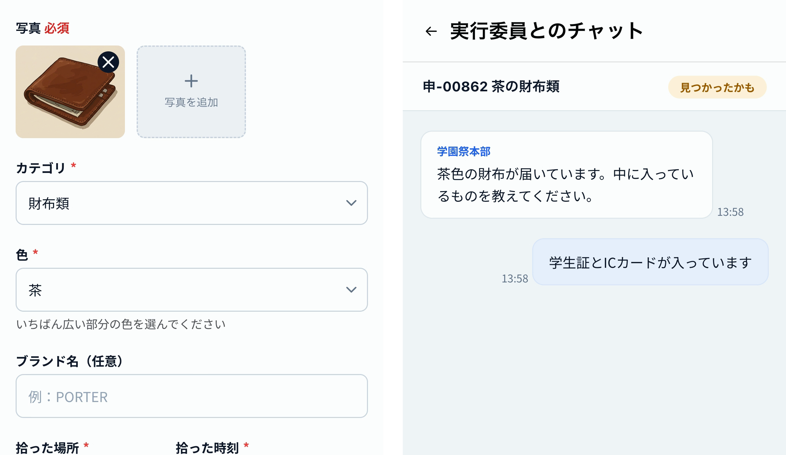
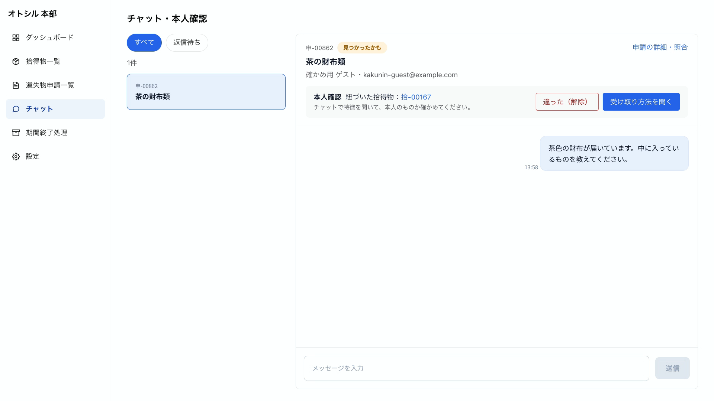

## Service Overview

This is a web app for managing lost items at Gidaisai, the school festival of Nagaoka University of Technology.
We built it in about two weeks at the 46th NUTMEG Hackathon, as a team of five called "Lightning Flower."

There are three kinds of users.

- **Visitors**: sign in with Google and report a lost item from their phone. They can check the status of their report, chat with the HQ, and choose how to pick the item up.
- **Festival staff**: register found items by taking a photo and choosing the category, color, and place where it was found.
- **HQ**: match found items with lost-item reports, confirm the owner through chat, and manage the handover. After the festival, the HQ also handles leftover items here (valuables go to the police, the rest are disposed of).

We also made a promo video.

<iframe src="https://www.youtube-nocookie.com/embed/FCTlfJRN_p0" title="Otoshiru promo video" style="width: 100%; aspect-ratio: 16 / 9; border: 0;" allow="accelerometer; clipboard-write; encrypted-media; gyroscope; picture-in-picture; web-share" referrerpolicy="strict-origin-when-cross-origin" allowfullscreen loading="lazy"></iframe>

## Why I Made This

I lose things a lot. But I have also been on the other side, managing lost items.
Having been in both positions, I felt that lost items are a real hassle for both the owner and the people managing them.

Also, picking up a lost item and handing it in is an act of kindness.
I wanted to build an app that makes lost items easier to manage, so that kindness actually reaches the owner.

## Why I Chose These Technologies

### Next.js + Chakra UI
To keep the screens and the API in one repository, we used the Next.js App Router and wrote the API as Route Handlers.
We added Chakra UI v3 from the start, so the screens look consistent even when five people split the work.

### Supabase + Drizzle
Supabase covers the database (PostgreSQL), photo storage, and Google sign-in for visitors.
Photos are kept in a private bucket, and we issue a signed URL only when a photo is shown.
The schema is written with Drizzle and managed as migrations.

### OpenAPI from zod
API inputs and outputs are written with zod, and `openapi.yaml` is generated from them.
This lets the people working on screens and the people working on the API build against the same spec.

### Vercel + Cloudflare Access
The app runs on Vercel.
The staff and HQ screens are on a separate domain behind Cloudflare Access (Zero Trust).
The API also verifies the Access JWT to decide whether the user is staff or HQ.

## What I Focused On

### As PM, an environment where everyone can start right away
Our team had both macOS and Windows users, so I set up a dev environment with Docker, make, and the Supabase CLI that works with the same steps (`make setup` → `make up`) on both.
GitHub Actions runs type checks, lint, tests, and the build, and also checks that `openapi.yaml` is up to date.

### Team development on the assumption that everyone uses Claude
This hackathon was my first time doing team development on the assumption that everyone uses Claude.
We wrote down in the README and docs who owns which folders and how to write an API, so that people and AI could follow the same rules.

### Making the promo video with Claude Code
I also made the promo video with Claude Code, for the first time.
It combines screen recordings of the app, and the narration is generated with a text-to-speech model running locally.

## Challenges

### Unused photos pile up
When someone edits a found item and replaces its photo, or when data is cleared after the festival, unused photo files are left in storage.
So we delete them from storage together with the database update.
We also wrote tests to make sure that if the database update fails partway, we don't delete photos that are still in use.

### Migration numbers collide
Drizzle numbers migrations in order, so if two people create one on separate branches, the numbers collide.
We made a rule that only the person in charge of the database changes the schema and generates migrations.

## Looking Back

We didn't win an award, but it was my first time doing team development built around Claude, and it was a great experience.
