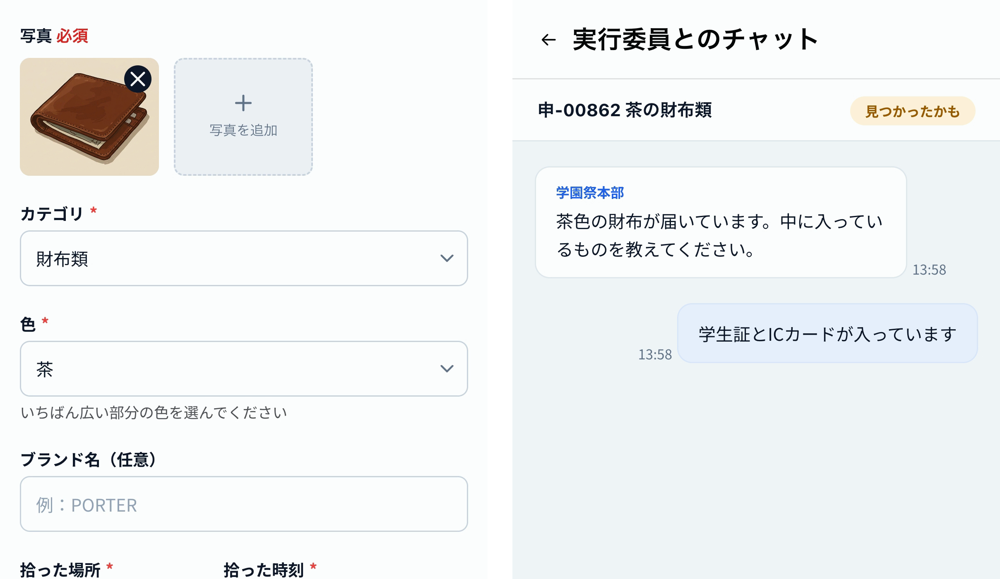
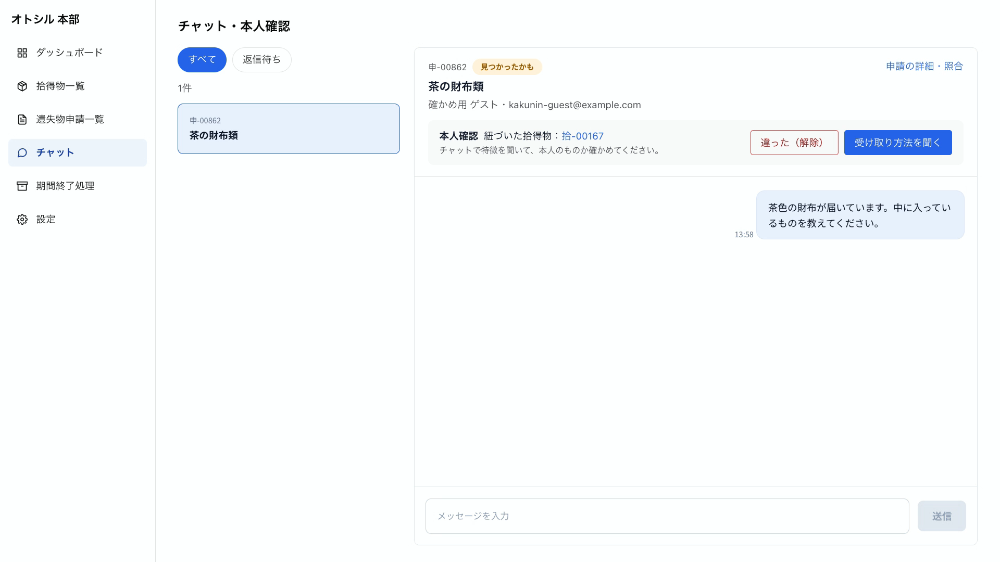

## サービス概要

技大祭（長岡技術科学大学の学園祭）の落とし物を管理するWebアプリです。
46th NUTMEG ハッカソンで、5人のチーム「Lightning Flower」として約2週間で開発しました。

使う人は3種類います。

- **来場者**：Googleでログインし、スマホから遺失物を申請します。申請の状況を確かめたり、本部とチャットしたり、受け取り方法を決めたりできます。
- **実行委員（スタッフ）**：拾った落とし物を、写真・カテゴリ・色・拾った場所を選んで登録します。
- **本部**：拾得物と遺失物申請を照合して紐づけ、チャットで本人確認をして、受け渡しまでを管理します。祭りが終わったあとの処理（貴重品は警察へ、それ以外は処分）もここで行います。

紹介動画も作りました。

<iframe src="https://www.youtube-nocookie.com/embed/FCTlfJRN_p0" title="オトシルの紹介動画" style="width: 100%; aspect-ratio: 16 / 9; border: 0;" allow="accelerometer; clipboard-write; encrypted-media; gyroscope; picture-in-picture; web-share" referrerpolicy="strict-origin-when-cross-origin" allowfullscreen loading="lazy"></iframe>

## 開発の思い

私はよく落とし物をします。一方で、落とし物を管理する側に回った経験もあります。
どちらの立場も経験して、落とし物が出ると、なくした人も管理する人もとても大変だと感じていました。

また、落とし物を拾って届けるという行動は、拾った人の善意に支えられています。
その善意をきちんと持ち主まで届けられるように、管理がしやすくなるアプリを作りたいと考えました。

## 技術選定の理由

### Next.js + Chakra UI
画面とAPIを1つのリポジトリにまとめるため、Next.jsのApp Routerを使い、APIはRoute Handlersで書いています。
UIはChakra UI v3を最初から入れ、5人で画面を分担しても見た目がそろうようにしました。

### Supabase + Drizzle
DB（PostgreSQL）・写真のストレージ・来場者のGoogleログインを、Supabaseひとつでまかなっています。
写真は非公開のバケットに置き、表示するときだけ署名付きURLを発行します。
スキーマはDrizzleで書き、マイグレーションとして管理しています。

### zod から OpenAPI を出力
APIの入出力はzodで書き、そこから`openapi.yaml`を出力しています。
画面担当とAPI担当が分かれていても、同じ仕様を見ながら開発できるようにするためです。

### Vercel + Cloudflare Access
本番はVercelで動かしています。
スタッフと本部の画面は別のドメインに分け、Cloudflare Access（Zero Trust）の内側に置きました。
APIでもAccessのJWTを検証し、スタッフか本部かを判定しています。

## こだわり

### PMとして全員がすぐ開発に入れる環境を作る
チームにはmacOSの人もWindowsの人もいたので、Docker・make・Supabase CLIで、どちらでも同じ手順（`make setup` → `make up`）で動く開発環境を作りました。
GitHub Actionsでは型チェック・Lint・テスト・ビルドと、`openapi.yaml`が最新かを確かめています。

### Claude の使用を前提にしたチーム開発
このハッカソンはClaudeの使用を前提にしたチーム開発に取り組んだ初めての機会でした。
READMEやドキュメントに、フォルダごとの担当やAPIの書き方をまとめ、人もAIも同じルールで書けるようにしました。

### Claude Code で紹介動画を作る
紹介動画も初めてClaude Codeを使って作りました。
アプリの画面の録画を組み合わせ、ナレーションはローカルで動く音声合成で生成しています。

## 開発で直面したこと

### 使われなくなった写真が残り続ける
拾得物を編集して写真を差し替えたり、祭りのあとにデータを消したりすると、ストレージに使われない写真のファイルが残ってしまいます。
そこで、DBの更新と合わせてストレージからも消すようにしました。
DBの更新が途中で失敗したときに、まだ使う写真を消してしまわないことも、テストで確かめています。

### マイグレーションの番号がぶつかる
Drizzleのマイグレーションは番号順に作られるため、2人が別々のブランチで作ると番号がぶつかります。
そこで、スキーマの変更とマイグレーションの生成はDB担当がまとめて行うルールにしました。

## 振り返り

受賞はできませんでしたが、Claudeの使用を前提にしたチーム開発は初めてで、とても良い経験になりました。
