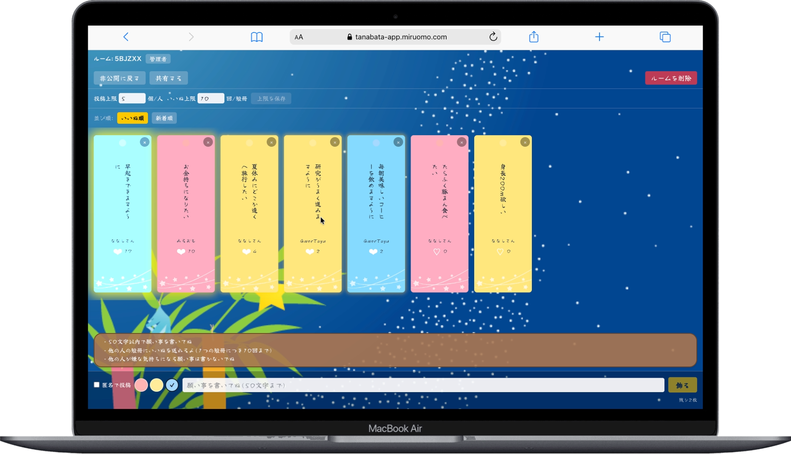
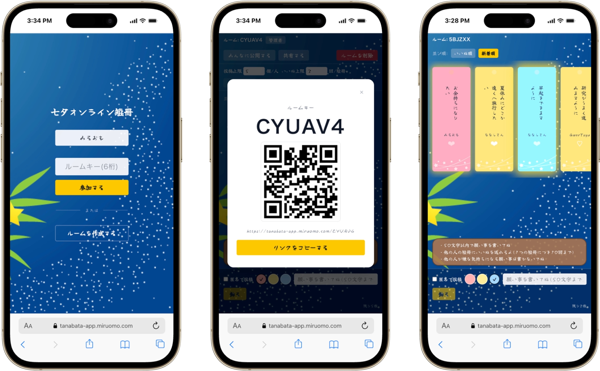

## Service Overview

This is a web app for icebreakers at in-person study groups and meetings. You write Tanabata wishes on paper strips (tanzaku) online and hang them up together.
There is no login screen. You just enter a nickname and a 6-character room key to join a "room."
Your tanzaku shows up on a shared board as a card with vertical text, and when people send likes with the heart, the card starts to glow.

The person who creates a room is the admin. They can share the room with a QR code, show or delete tanzaku, and change the posting limits.

## Why I Made This

My computer club happened to have a meeting on the day of Tanabata.
That morning, I thought it would be fun to do an icebreaker, so I decided to build "an app where everyone writes tanzaku online and hangs them up together" and use it that same day.

I took the idea from [an article](https://note.com/sales_wsff/n/n8ded5427462c) about a company Tanabata event, held because people had fewer chances to connect while working remotely.
They collected wishes with a form tool (formrun) and put them together by hand in Canva.
I thought, why not make it a real web app that works in real time?

My goal was to finish it in six hours on the day, so the first version was simple: no auth and only the free tier.
After we used it in a real meeting, we decided to open it to people outside the club, so in October 2026 I rebuilt it as v2 with stronger protection against cheating.

## Why I Chose These Technologies

With only six hours, the first thing I did was decide early what I would *not* build.
The first version had no auth, fully open Firestore rules, and limits counted only in localStorage — the smallest setup that works without auth — so I could spend my time on the experience of hanging tanzaku together.

### Next.js + TypeScript + Tailwind CSS
I kept it to just three screens — top, participant, and admin — and used the room key directly in the URL (`/{roomId}`, `/{roomId}/admin`).

### Firebase (Firestore + Anonymous Auth)
I used Firestore's `onSnapshot` to show new tanzaku in real time without writing a server.
The app reads and writes only from the Firebase client, with no API Routes or `firebase-admin`.
In v2, I added Anonymous Authentication so each browser gets an ID that can't be faked, still without a login screen.

## What I Cared About Most

### A Tanabata look and feel
Tanzaku text is shown vertically with `writing-mode: vertical-rl`, and you can pick a red, yellow, or blue tanzaku when you post.
The more likes a tanzaku gets, the more it glows, so you can see popular wishes at a glance.

### Nicknames that prevent impersonation
If you could type any name each time you wrote a tanzaku, you could pretend to be someone else in the same room.
So you enter your nickname only once, when you join a room, and you can't change it inside the room after that.
For each post, you only choose whether to show your name. If you hide it, the tanzaku is posted as "Nanashi-san" (Anonymous).

### A "reveal" toggle to stay in the free tier
Until the admin presses "Show to everyone," participants only subscribe to their own tanzaku.
If everyone kept subscribing to every tanzaku, Firestore reads would add up, so this keeps the app within the free Spark plan.
It also makes a nice moment: when the admin reveals, everyone else's tanzaku appear on all screens in real time.

### Easy sharing on the spot
From "Share" on the admin screen, you can show the room key in large text along with a QR code for the join link.
The QR code is made in the browser with `qrcode.react`, without any external API.

## Problems I Faced

### The posting and like limits could be bypassed
In the first version, the limits — up to 5 tanzaku per person and up to 3 likes per tanzaku — were only counted in localStorage.
Anyone could get past them by editing the values in developer tools, and the Firestore rules were fully open, so I rebuilt it before opening it outside the club.

In v2, the poster ID is the Anonymous Auth `uid`. Post and like counters go up by one in the same transaction that creates the tanzaku, and the Firestore security rules check those values.
To block a trick where one batch write raises the counter once but creates many tanzaku, I fixed each tanzaku's document ID to `{uid}__{counter value}`.
I wrote tests for the rules and ran them on the Firestore emulator.
